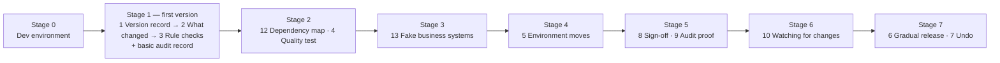

# Project context — read this first

**Audience:** any person or Claude session starting work on this repository.
**Purpose:** what we're building, why, in what order, where things stand, and what is
still undecided. Rules live in [`CLAUDE.md`](../CLAUDE.md); setup in
[`CONTRIBUTING.md`](../CONTRIBUTING.md); decisions in [`decisions/`](decisions/README.md).

_Last updated: 2026-10-24 — Stage 0 nearly done, Stage 1 starting._

---

## 1. In one paragraph

AI agents — programs that use an AI model to take actions through tools — are being
deployed into companies' business systems. Today they are often released like scripts:
no record of what changed, no rule checks, no approvals, no safe way back. This project
builds **release management for AI agents**: a record of every agent version, a summary
of what changed between versions, automatic rule checks, and — in later stages —
dependency tracking, pre-release quality tests, safe promotion from testing to live use,
sign-off by the right people, audit evidence, alerts when outside systems change, gradual
rollout and undo. It runs **inside a CI/CD pipeline**, starting with **GitHub Actions**.

## 2. Words used in the plan

| Term | Meaning here |
|------|--------------|
| **Agent** | A program using an AI model plus tools (search, read files, call APIs…) to do tasks. Described by an `agent.toml` manifest ([format](agent-manifest.md)). |
| **Version** | One exact state of an agent — its manifest, code and configuration — identifiable so it can be compared, checked, approved and released. |
| **Business system** | An outside system an agent connects to, e.g. a CRM, ticketing tool or database. Which ones matter first is an [open question](#8-open-questions). |
| **Environment** | Where an agent runs: e.g. *testing* and *live*. Each has its own connection settings. |
| **Pipeline** | The automated steps (CI/CD) that test and release software. Ours plugs into GitHub Actions first. |
| **Platform** | A system where agents are built or run. "One view across all platforms" means supporting several over time. |

## 3. The 13 features

Numbers are the plan's feature numbers; they are referenced everywhere (backlog, ADRs, PRs).

| # | Feature | What it means | Stage | Needs |
|---|---------|---------------|-------|-------|
| 1 | **Version record** | A clear, permanent record of every agent version. Everything else reads from it. | 1 | — |
| 2 | **"What changed" summary** | Compare two versions and explain the differences. | 1 | 1 |
| 3 | **Automatic rule checks** | Check a version against rules; block it in the pipeline if it breaks one. Some rules use the "what changed" summary. | 1 | 1 (+2) |
| 12 | **Dependency map** | Which agents use which tools and business systems. | 2 | 1 |
| 4 | **Quality test before release** | Run an agent against test tasks before release. Basic version works without fake systems. | 2 | 1 (better with 13) |
| 13 | **Fake business systems** | Ready-made stand-ins for real systems, for realistic, safe testing. | 3 | — |
| 5 | **Moving between environments** | Promote safely from testing to live, incl. per-environment connection setup and connection checks before release. | 4 | 1 (checks need 13) |
| 8 | **Sign-off from the right people** | Ask the right approvers, judged by risk, at the right moment. | 5 | 2, 5 |
| 9 | **Proof for audits** | Evidence of what was released, checked and approved. A **basic audit record starts in Stage 1** and grows each stage. | 5 (basic from 1) | all before |
| 10 | **Watching for outside changes** | Alert when a business system changes, and which agents are affected. | 6 | 4, 12 |
| 6 | **Releasing to a few users first** | Gradual rollout. | 7 | 5, 4 |
| 7 | **Undoing a bad release** | Roll back, including undoing the bad release's effects. Hardest; last. | 7 | 6, 5, 13 |
| 11 | **One view across all platforms** | Ongoing: each supported platform is added over time, starting with whichever the first users run. | ongoing | — |

## 4. Roadmap

Order: **0 → 1, 2, 3 → 12, 4 → 13 → 5 → 8, 9 → 10 → 6, 7**, with **11** growing throughout.

**Stage 1 is the one-month first version.** Decisions taken on the plan's open choices
([ADR 0009](decisions/0009-staged-roadmap.md)):

| Choice in the plan | Decided |
|--------------------|---------|
| Move 12 and/or 4 into Stage 1? | **No** — Stage 1 stays 1, 2, 3 |
| Build 13 (fake systems) alongside Stage 1? | **No** — Stage 3 as planned; until then tests use scripted sample agents and fake tools |
| Start a basic audit record in Stage 1? | **Yes** — every feature writes to it from day one |
| Put 10 (watching) after Stage 7? | **No** — Stage 6 as planned |
| Language / first pipeline / license (Stage 0) | Python 3.11+ / GitHub Actions / Apache-2.0 (ADRs 0001–0003) |

## 5. Where we are now

| Stage | Status |
|-------|--------|
| 0 — Dev environment | ✅ Repo, protected `main` (ruleset `protect-main`), decision log, backlog, `CLAUDE.md`, CI on every change, sample agents, learning notes, contributor guide. **Left:** free test accounts (S0-4), secret scanning (S0-6). |
| 1 — First version | 🟡 Starting. First piece — the `agent.toml` manifest format, groundwork for feature 1 — is PR #2. |
| 2–7 | ⬜ Not started |

Live status of every item: [`BACKLOG.md`](../BACKLOG.md).

## 6. How the existing code fits the plan

| Exists today | Role in the plan |
|--------------|------------------|
| `src/.../manifest.py` + [`agent-manifest.md`](agent-manifest.md) | Describes what an agent *is* (tools, limits, entrypoint). The content a **version record** (1) captures; rules (3) read it. |
| `src/.../cli.py` | Command-line entry point. Stage 1 adds commands that run in the pipeline. |
| `sample_agents/` (4 scripted agents + fake tools) | Test fixtures. Their manifests feed 1–3; their scripted misbehaviour (undeclared tool, leaked secret, step overrun) is groundwork for the **quality test** (4) until fake systems (13) exist. |
| `.github/workflows/ci.yml` | Our own checks. The product's own GitHub Action comes in Stage 1. |
| `learning/` | Beginner explanations of every change (rule 7 in `CLAUDE.md`). |

## 7. Design principles (so far)

- **Fail loudly.** Anything unclear is an error, never silently ignored (ADR 0007).
- **Everything traceable.** Versions, checks and approvals must be explainable later —
  this is a compliance product, so its own history must be clean too.
- **Pipeline-first.** Every feature is usable as a command with clear exit codes, so any
  CI system can run it. Platform-specific parts are thin adapters (ADR 0002).
- **Zero runtime dependencies** until an ADR justifies one (ADR 0001).
- **Deterministic tests** — no network, no real AI model in the default test run (ADR 0005).

## 8. Open questions

Not decided yet. Don't assume an answer — ask the owner, and record the decision as an ADR.

1. **First users:** who runs the first version — the owners' own agents, a specific company, a type of team?
2. **First agent platform (feature 11):** which platform's agents are supported first?
3. **First business systems:** which systems do early users' agents connect to? (Shapes 12, 13, 5, 10.)
4. **Compliance scope of rule checks (3):** which rules first — security basics, personal data, a regulation (e.g. EU AI Act), company policies?
5. **Where version records live (1):** files in the agent's repo, a separate store, a database? Needs an ADR before feature 1 is built.
6. **What exactly a "version" contains:** manifest only, or also code, prompts, model settings?
7. **First-version deadline:** the one-month target's start/end dates.

## 9. Team

| Who | Role | Works through |
|-----|------|---------------|
| Jahanvi Joshi (`@jahanvi15`) | Owner, maintainer, decision-maker | Claude; Windows |
| Second contributor | Collaborator (write) | Their own Claude; Windows |

Both are learning as the project grows: explain steps in plain words and offer options
with trade-offs for every decision. Working agreements: `CLAUDE.md`, "Working with more
than one person".

## 10. History so far

| Date | What happened | Details |
|------|---------------|---------|
| 2026-10-23 | Stage 0 choices made: Python, GitHub Actions, Apache-2.0 | ADRs 0001–0003 |
| 2026-10-23 | Skeleton pushed (`f1c54de`); first CI run green | Journal 0001 |
| 2026-10-23 | Accidental commit with a real email removed before `main` was locked | Journal 0001, problem 9 |
| 2026-10-23 | `main` locked by ruleset; learning notes added (PR #1); merge-commit style chosen | ADR 0006, journal 0002 |
| 2026-10-23 | Manifest format built (PR #2) | ADR 0007 (proposed), journal 0003 |
| 2026-10-24 | Second contributor onboarding; 0 required approvals kept | ADR 0008, journal 0004 |
| 2026-10-24 | Full 7-stage roadmap recorded; backlog realigned to it | ADR 0009, journal 0005 |

## 11. Keeping this document current

Update it in the same PR whenever a stage changes status, an open question is answered,
or a feature's scope changes (rule in `CLAUDE.md`). Change the "Last updated" line.
